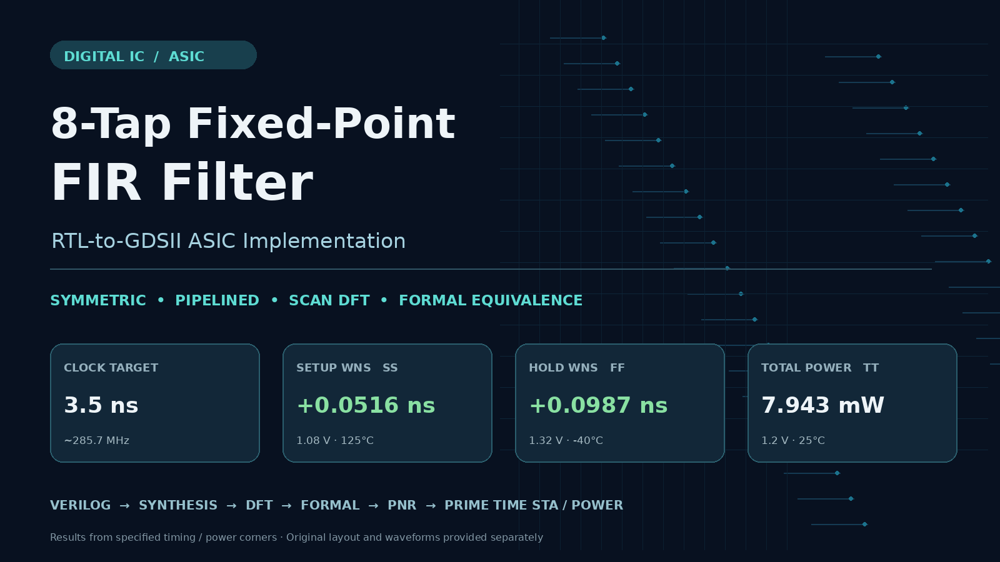
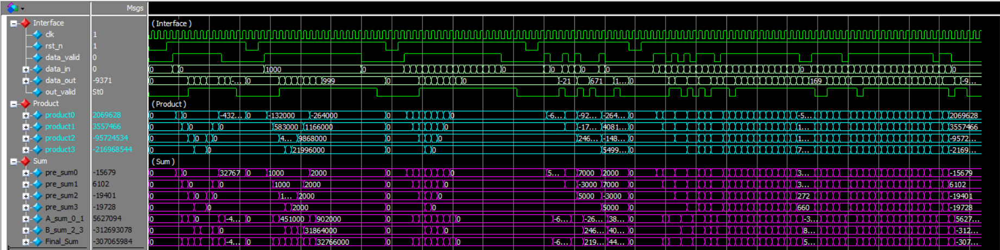
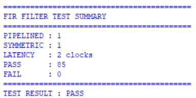

# 8-Tap Fixed-Point FIR Filter — RTL-to-GDSII ASIC Implementation

An ASIC case study of a symmetric, pipelined FIR filter implemented in Verilog. The project follows the design from RTL simulation through synthesis, scan insertion, formal equivalence, physical implementation, and extracted-parasitic timing and power analysis.

## Final results

| Metric | Result | Basis |
|---|---:|---|
| Clock target | **3.5 ns** | Post-route setup clock period |
| Setup WNS | **+0.0516 ns** | PrimeTime, SS at 1.08 V and 125 °C |
| Functional hold WNS | **+0.0987 ns** | PrimeTime, FF at 1.32 V and −40 °C |
| Total power | **7.943 mW** | PrimeTime time-based analysis, TT at 1.2 V and 25 °C |
| DFT scan chains | **2** | Multiplexed scan configuration |

The [results notes](docs/RESULTS.md) describe the analysis conditions and limits. The [EDA report index](reports/README.md) links all 38 tool exports, including 14 copies with marked redactions. Key evidence includes [DFT coverage](reports/tool_exports/dft/coverage_dft.rpt), [post-synthesis Formality](reports/tool_exports/formality/post_synthesis/passing_points.rpt), [post-DFT Formality](reports/tool_exports/formality/post_dft/passing_points.rpt), [Encounter setup](reports/tool_exports/encounter/FIR_Filter_postRoute.summary) and [hold](reports/tool_exports/encounter/FIR_Filter_postRoute_hold.summary), [PrimeTime setup](reports/tool_exports/primetime/setup_timing.rpt) and [functional hold](reports/tool_exports/primetime/hold_timing.rpt), and [time-based power](reports/tool_exports/primetime/power_tt.rpt).

## RTL design and simulation

The filter accepts signed 16-bit samples and uses signed Q1.15 coefficients. Its nominal DSP design uses a 48 kHz sample rate and an approximately 8 kHz cutoff. The final [RTL](rtl/FIR_Filter.v) defaults to the symmetric, pipelined configuration and a signed 20-bit output. It uses four symmetric sample pairs and a 35-bit accumulation path with fixed-point scaling and saturation. The integer coefficients are `[-132, 583, 4934, 10998, 10998, 4934, 583, -132]`.

Original console captures show [impulse and DC tests](docs/images/rtl_test_cases_1_2.png), [alternating input and valid gaps](docs/images/rtl_test_cases_3_4.png), and [random samples](docs/images/rtl_test_case_5.png).

The captured simulation records 85 passes, zero failures, and two cycles of latency. The [testbench](tb/README.md) observes a 16-bit output, so the captured results cover that test configuration. The [scan-interface variant](rtl/FIR_Filter_DFT.v) and [optional clock and reset wrapper](rtl/TOP_optional_wrapper.v) are also included. The documented implementation top is `FIR_Filter`.

## ASIC implementation flow

| Stage | Project work | Reference |
|---|---|---|
| Logic synthesis | Synopsys Design Compiler elaboration and technology mapping. The earlier synthesis script targets 5 ns. | [Synthesis scripts](scripts/synthesis/) |
| Scan DFT | Multiplexed scan-flop insertion configured for two chains with a 3.5 ns stage constraint. | [DFT scripts](scripts/dft/) |
| Formal equivalence | Synopsys Formality compares RTL with the synthesis and scan-inserted netlists. Post-DFT checking uses functional mode with scan enable held low. | [Formal scripts](scripts/formal/) |
| Physical design | Cadence First Encounter floorplanning, placement, clock-tree synthesis, routing, hold fixing, filler insertion, and GDS export. | [Physical design scripts](scripts/pnr/) |
| Post-layout STA | Synopsys PrimeTime analyzes setup and functional hold with extracted SPEF. The reported WNS differs from the corresponding Encounter results by 2.6 ps for setup and 0.3 ps for hold. | [STA scripts](scripts/sta_power/) |
| Time-based power | PrimeTime applies simulation VCD activity and routed parasitics at TT. | [Power analysis details](docs/RESULTS.md#time-based-power-analysis) |

The reported setup and hold results apply to the stated corners and functional settings. Review [constraints provenance](constraints/) and [script setup](scripts/) for the scope of the reference files and their external dependencies.

## Repository contents

- [rtl/](rtl/) contains the functional and scan-interface variants and optional wrapper.
- [tb/](tb/) contains the SystemVerilog testbench and simulator command files.
- [constraints/](constraints/) describes the synthesis, DFT, and final timing targets.
- [scripts/](scripts/) contains sanitized Tcl and simulation scripts.
- [reports/](reports/) indexes the original reports by stage, tool, and filename.
- [docs/](docs/) contains analysis notes and functional simulation captures.
- [tools/](tools/) and the [GitHub Actions workflow](.github/workflows/release-guard.yml) provide release checks.

See the [rights and publication policy](RIGHTS_AND_PUBLICATION.md) and [license notice](LICENSE). Run `python tools/check_public_release.py` from the repository root for the automated file and path checks.
